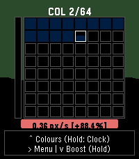
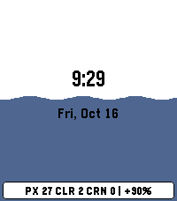
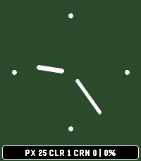
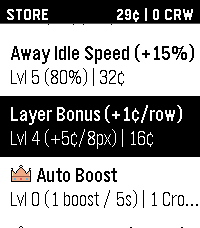

# Idle 64 (Idle_Pixel)

An immersive, retro-inspired incremental idle game and clock face built in C for Pebble color smartwatches (**Pebble Time 2 / emery**).

<p align="center">
  
  
  
  
</p>

---

## 🎮 Game Logic & Progression

Idle 64 is structured into a multi-tiered incremental progression system: **Pixels**, **Colours**, and **Crowns**.

```
+---+--------------------------+
|   |  COL 1/64 | 👑 0         |
|   +--------------------------+
| 6 |                          |
| 4 |  [■][■][■][■][■][■][■][■]|
|   |  [■][■][■][■][■][■][■][■]|
| S |  [■][■][■][▓][ ][ ][ ][ ]|  <-- Pixels (8x8 Live Canvas)
| L |  [ ][ ][ ][ ][ ][ ][ ][ ]|
| I |  [ ][ ][ ][ ][ ][ ][ ][ ]|
| C |  [ ][ ][ ][ ][ ][ ][ ][ ]|
| E |  [ ][ ][ ][ ][ ][ ][ ][ ]|
| S |  [ ][ ][ ][ ][ ][ ][ ][ ]|
+---+--------------------------+
|      3.64 px/s [+550.0%]     |
+------------------------------+
|   ^ Colours (Hold: Clock)    |
|   > Menu | v Boost (Hold)    |
+------------------------------+
```

### 1. Pixels (Tier 1: 8x8 Live Canvas)
- **The Canvas**: An 8x8 grid (64 pixels) that fills with a single, solid color selected sequentially from the 64-color Pebble hardware palette.
- **Base Speed**: Starts at 10.0 seconds per pixel (0.10 px/s), upgradeable in the Store and boostable with manual clicks or continuous hold auto-pressing.
- **Layer Earnings**: Each completed 8-pixel layer pays out Layer Bonus currency (`1¢ + 1¢/lvl`).
- **Seamless Meld & Screen-Grow Animation**: When the 64th pixel completes, the 8x8 grid fuses into a solid block, expands across the screen, and evaporates via smooth scanline dithering into the background—with **zero delay** in starting the next colour underneath.

### 2. Vertical Progress Gauge (64 Slices)
- Located directly to the left of the active canvas.
- Divided into 64 vertical slices building from bottom to top.
- Each completed 8x8 Colour grid fills 1/64th of this gauge with its corresponding color.

### 3. Colours (Tier 2: 64-Colour Master Grid)
- Pressing **`UP`** from the active canvas zooms out to the Colours overview.
- Displays all 64 color slots of the full Pebble palette:
  - Completed colours appear as solid colored tiles.
  - The currently filling colour shows live progress and active border highlights.
  - Future slots remain empty.
- Pressing **`DOWN`** or **`BACK`** zooms smoothly back into the active canvas.

### 4. Crowns (Tier 3: Winning & Global Prestige)
- Completing all 64 Colours finishes the entire 64-colour palette (4,096 total pixels).
- **Winning the Game**: Completing a save awards **1 Crown (`👑`)** to the persistent **Global Crown Bank**.
- **Victory Celebration**: Filling all 64 colours triggers a 45-particle fireworks celebration over the victory card and lifetime stats (total time, in-game time, away time, unlocks, and earnings). Players can choose to keep going in endless mode or start a new run.
- **Crown Perks**: Crowns can be spent in the Store from any save slot on universal perks that persist across all save files and new runs.

### 5. Prestige
- Accessible from the Main Menu at any time after completing $\ge 1$ Colour.
- **True Potential Payout**: Cash payout dynamically scales with your Layer Bonus upgrades:
  $$\text{Payout} = \text{total\_completed\_layers} \times (1 + \text{upgrade\_layer\_cents\_lvl})$$
- **Speed Multiplier**: Grants a permanent **+5% fill speed bonus per prestige level**.
- Resets current Colours & Pixels while preserving all Crowns, currency, upgrades, and cosmetic unlocks.

---

## 🎨 UI & Aesthetics

- **Liquid Wipe Animation**: Pixels fill smoothly with highlighted borders following the chosen fill order.
- **Dynamic Auto-Contrasting Background**: By default (`Auto`), backgrounds dynamically adapt between dark and light modes depending on the active filling color's luminance.
- **Liquid Ink Boost Visual**: Activating boost causes ink to rise from the bottom of the screen with live sloshing physics.
- **Real-Time Telemetry**: Live pixels-per-second (`px/s`) telemetry calculated directly from current base speed, prestige bonus, and momentum multiplier.

---

## 🕹️ Controls & Navigation

### Main Screen (Active Canvas)
| Button | Action | Description |
| :--- | :--- | :--- |
| **`UP`** | **Zoom Out** | Open the 64-Colour overview. |
| **`UP (Hold)`** | **Clock Face** | Open the clock face view. |
| **`SELECT`** | **Menu** | Open the main menu. |
| **`DOWN`** | **Boost** | Add filling momentum (+5% base gain, compounds with repeat presses). |
| **`DOWN (Hold)`** | **Auto-Boost** | Rapid auto-press boost at your purchased hold boost rate. |

### Colours Screen (64-Colour Grid)
| Button | Action | Description |
| :--- | :--- | :--- |
| **`DOWN` / `BACK`** | **Zoom In** | Return to the active filling canvas. |
| **`SELECT`** | **Menu** | Open the main menu. |
| **`UP (Hold)`** | **Clock Face** | Open the clock face view. |

### Clock Face Screen
| Button | Action | Description |
| :--- | :--- | :--- |
| **`UP`** | **Cycle BG Color** | Cycle through all unlocked background colors and Auto Contrast. |
| **`SELECT`** | **Cycle Style** | Cycle through unlocked clock styles on the fly. |
| **`DOWN` (Press/Hold)**| **Boost** | Boost filling with live liquid wave animation behind the clock face. |
| **`BACK`** | **Exit Clock** | Return to the game canvas. |

*Note: While on the clock face, game progression rolls over continuously without preview confirmation pauses or idle caps.*

---

## 🌟 Menus & Systems

### Main Menu
1. **Prestige**: Reset Colours & Pixels for upgraded cash payout and permanent +5% speed. Live preview displays colors completed and currency to be earned.
2. **Store**: 14 data-driven store upgrades and crown perks with automatic marquee scrolling on longer titles.
3. **Unlocks**: Unlockable background colors, fill orders, fonts, font sizes, and clock styles.
4. **Clock**: Full-screen interactive clock face.
5. **Options**: Global watch settings and preferences.
6. **Save Slots**: Dynamic multi-slot save manager supporting up to 64 saves.

### 🛒 Store Upgrades
All upgrades feature declarative cost scaling, live stat formatters, and marquee text scrolling:

#### Standard Cents Upgrades (2.0x Cost Curve)
1. **Auto-Fill Speed (+10%)**: Baseline interval compound reduction.
2. **Boost Amount (+5%)**: Momentum added per click.
3. **Boost Acceleration (+10%/s)**: Rate at which boost climbs to peak.
4. **Boost Sustain Duration (+500ms)**: Peak hold duration before decay.
5. **Boost Diminish Rate (-20%)**: Slower momentum decay rate.
6. **Boost Max Limit (+25%)**: Calibrated between +100% (2.0x) and +300% (4.0x).
7. **Hold Auto-Press (+10%)**: Base 1.0 click/s up to rapid fire.
8. **Max Idle Time (+50%)**: Formula B compound scaling starting at **5 minutes** up to a 24-hour ceiling at Level 14 (5m, 8m, 12m, 18m, 27m, 40m, 1h, 1h30m, 2h15m, 3h20m, 5h, 7h30m, 11h15m, 16h40m, 24h).
9. **Away Idle Speed (+15%)**: Closed-game speed starting at 10% base up to 100% efficiency at Level 6.
10. **Layer Bonus (1.5x/row)**: 1.5x compounding income per completed 8-pixel layer (1¢, 2¢, 4¢, 7¢, 12¢, 20¢, 35¢, 60¢, $1.00...). Easily outpaces the 2.0x cost curve to unlock high-tier store upgrades.

#### Crown Perks (Persistent Across All Saves — 1 Crown Each)
11. **👑 Auto Boost**: Fires 1 auto boost on an interval. Purchasable 5 times, taking 1 second off the interval each level (5s down to 1s at Level 5).
12. **👑 Clock Boost (+20%)**: +20% boost momentum while on the clock face per level.
13. **👑 Starting Headstart**: +$0.50 starting bankroll for new runs in any save slot per level.
14. **👑 Start Level**: Adds +1 extra level to all standard store upgrade items across all saves and on new saves per level.

### 🎨 Cosmetic Unlocks (36 Total Items)
Spend unlock points earned from completing colours:
- **Background Colors (19)**: Curated Pebble palette colorways with live preview swatches + default Auto Contrast. Light and dark shades are interleaved evenly across contrasting hues (blues, purples, oranges, greens, reds).
- **Fill Orders (7)**: Normal (default), Reverse, CW Spiral, CCW Spiral, Zig-Zag, Up and Down, Checkerboard, and Random.
- **Fonts (3)**: Gothic (default), Bitham, Leco, and Roboto.
- **Font Sizes (2)**: Small (default), Medium, Large. Affects typography and structural elements across all clock styles:
  - *Square Analogue*: Hand width and outer bezel border thickness scale with font size.
  - *Bold Minimalist*: Dot radius, hand strokes, and border rim scale with font size.
  - *7-Segment*: Digit heights scale dynamically with font size.
- **Clock Styles (5)**: Big Digital (default), Square Analogue, Bold Minimalist, 7-Segment, Word Clock, and "Now" Clock.

*Unlocks continue progressing while the game is closed. Winning a run automatically guarantees enough unlock points to unlock every cosmetic item in the game.*

### 💾 Save Slots & Global Persistence
- **Up to 64 Save Slots**: Top header displays slots used and total crowns earned/unspent. Lists existing saves with start date, playtime, win badges (`👑 Won`), and active indicator (`[Active]`), followed by a `[+] Add New Save` button.
- **Safe Switching**: Loading saves uses `idle_pixel_pop_to_root()` to dismiss menus cleanly.
- **Global Settings & Crown Bank**: Global options (`Time Format`, `Seconds`, `Vibration`, `Tap to Wake`) and the **Crown Bank** are stored globally under `PERSIST_KEY_GLOBAL_CONFIG`, ensuring crowns and crown perks persist across all saves and prestiges. Dev menu is disabled by default (`ENABLE_DEV_MENU 0`) for production releases.

---

## 🛠️ Building & Installation

### Requirements
- Pebble SDK (v4.3 or modern RePebble toolchain)
- ARM Embedded GCC (`arm-none-eabi-gcc`)

### Commands
```bash
# Build the .pbw package for Pebble Time 2 (Emery)
pebble build

# Run in Pebble emulator
pebble install --emulator emery

# Install to physical watch via CloudPebble / phone proxy
pebble install --cloudpebble
pebble install --phone <PHONE_IP_ADDRESS>
```

---

## 📜 License
MIT License.
